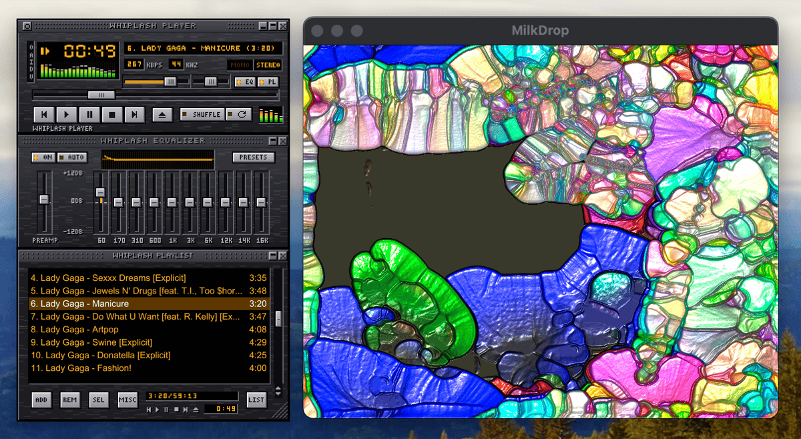

# Whiplash Player

A native music player for macOS, Linux and Windows that uses classic Winamp 2.x skins (`.wsz` files). Whiplash (`whiplash` for short) lives at <https://github.com/platypuscreations/whiplash>.

- Plays MP3, FLAC, Ogg Vorbis, WAV, AIFF and AAC/ALAC (M4A).
- Plays from an Emby server or a Logitech Media Server, browsing its library in the playlist window.
- Shows the classic spectrum analyzer or oscilloscope in each skin's colors.
- Has a 10-band equalizer that loads and saves Winamp `.eqf` presets.
- Has a resizable playlist editor that reads and writes M3U and PLS playlists.
- Windows snap and dock together, shrink to strips ("shade mode"), and are remembered between runs.
- Plays MilkDrop visualizations in their own window.



*Shown with Whiplash's built-in skin. Whiplash also plays classic Winamp skins, and is not affiliated with Winamp.*

## Install

Download Whiplash from the **[latest release](https://github.com/platypuscreations/whiplash/releases/latest)**. Under **Assets**, pick the file for your computer:

| Computer | File |
|---|---|
| Mac with Apple silicon | `whiplash-<version>.dmg` |
| Debian, Ubuntu, Linux Mint and similar (64-bit PC) | `whiplash_<version>-1_amd64.deb` |
| Other Linux (64-bit PC) | `whiplash-<version>-x86_64.AppImage` |
| Windows 10 or 11 (64-bit PC) | `whiplash-<version>-x86_64.msi` |

`<version>` is the release number, for example `0.1.0`.

### macOS

Needs a Mac with Apple silicon (M1 or later) and macOS 11 or later. On an Intel Mac, [build from source](#building-from-source) instead.

1. Double-click the downloaded `.dmg` file.
2. Drag **Whiplash Player** onto the **Applications** folder in the window that opens.
3. Open Whiplash Player from Applications. It's free software without a paid Apple developer signature, so macOS blocks it the first time:
   - **macOS 15 (Sequoia) and later:** macOS says "Whiplash Player" Not Opened. Click **Done**. Then open **System Settings → Privacy & Security**, scroll down to the message that Whiplash Player was blocked, and click **Open Anyway**. Confirm with your password, and click **Open Anyway** once more.
   - **macOS 14 and earlier:** right-click (or Control-click) Whiplash Player in Applications, choose **Open**, then click **Open** again.

   You only need to do this once. If you prefer the Terminal, this does the same thing:
   ```sh
   xattr -dr com.apple.quarantine "/Applications/Whiplash Player.app"
   ```

### Linux

The downloaded packages are for 64-bit PCs (x86-64). For ARM computers, such as a Raspberry Pi, [build the packages yourself](#packaging).

Use whichever package suits your system. The commands below use version 0.1.0; change the number to match your download.

- **Debian, Ubuntu, Linux Mint and similar:** install the `.deb`, which adds Whiplash Player to your applications menu:
  ```sh
  sudo apt install ./whiplash_0.1.0-1_amd64.deb
  ```
  To start it from a terminal, run `whiplash`.
- **Any other distribution:** use the AppImage, which runs without installing:
  ```sh
  chmod +x whiplash-0.1.0-x86_64.AppImage
  ./whiplash-0.1.0-x86_64.AppImage
  ```
  If it complains about FUSE, install `libfuse2` (on Ubuntu 24.04 and later: `libfuse2t64`). Or run it with `--appimage-extract-and-run`.

Whiplash uses `zenity` for a few message boxes (file info, About). The `.deb` asks for it; with the AppImage, install it from your distribution if those boxes don't appear.

### Windows

Needs Windows 10 or 11 on a 64-bit PC (x86-64).

1. Double-click the downloaded `.msi` file.
2. It's free software without a paid code-signing certificate, so Windows may say **Windows protected your PC**. Click **More info**, then **Run anyway**.
3. Windows asks whether to let it make changes; click **Yes**. Whiplash installs into Program Files and adds **Whiplash Player** to the Start menu.

To remove it, open **Settings → Apps**, find Whiplash Player, and choose **Uninstall**. Installing a newer version replaces the old one.

### Development builds

To try changes made since the last release: every change on the `main` branch is built automatically, and the packages are kept for 90 days. Sign in to GitHub, open the [list of successful builds](https://github.com/platypuscreations/whiplash/actions/workflows/build.yml?query=branch%3Amain+is%3Asuccess), click the newest one, and download `whiplash-macos`, `whiplash-linux` or `whiplash-windows` from **Artifacts** at the bottom. Each is a `.zip` file holding the same packages as a release.

## Skins

Whiplash comes with its own skin, **Whiplash**: graphite metal with an amber display, laid out like the classic Winamp skins so every button is where you'd expect it. It's what you see until you choose another skin, and you can go back to it any time: right-click the main window, choose **Skin browser...** (or press Alt+S), and pick **Whiplash (built-in)**.

Whiplash also plays classic Winamp skins (`.wsz` files). The [Winamp Skin Museum](https://skins.webamp.org/) has tens of thousands of them, free. A good one to start with is the original Winamp look, base 2.91.

### Get the original Winamp look (base 2.91)

1. Open the skin's page in the museum: <https://skins.webamp.org/skin/2f245e741b6bd4e1a122a28489f0c7b7>. You can also search the museum for `base-2.91`.
2. Click the **Download skin** button. Your browser saves `base-2.91.wsz`, usually in your Downloads folder.
3. Drag `base-2.91.wsz` onto Whiplash's main window. The skin changes straight away, and Whiplash remembers it next time. Whiplash moves the file out of Downloads into its **Skins** folder, so it's kept safe and shows up in the skin browser (Alt+S).

Or download it straight into the Skins folder from a terminal:

```sh
# macOS
mkdir -p ~/Library/Application\ Support/whiplash/Skins
curl -L -o ~/Library/Application\ Support/whiplash/Skins/base-2.91.wsz \
  https://r2.webampskins.org/skins/2f245e741b6bd4e1a122a28489f0c7b7.wsz

# Linux
mkdir -p ~/.config/whiplash/Skins
curl -L -o ~/.config/whiplash/Skins/base-2.91.wsz \
  https://r2.webampskins.org/skins/2f245e741b6bd4e1a122a28489f0c7b7.wsz
```

Then press Alt+S in Whiplash and choose **base-2.91**.

### More skins

Browse or search the [museum](https://skins.webamp.org/), and use the same steps for any skin you like:

- **Try before you download:** a skin's page has a button that opens it in Webamp, so you can see it in action first.
- **Classic skins only:** Whiplash plays classic skins (`.wsz`). Winamp 3 and 5 "modern" skins (`.wal`) aren't supported.
- **Switching skins:** the skin browser (Alt+S) lists the skins in your Skins folder and in the folder of the skin you're using, up to 40 of them. You can also drop any `.wsz` file onto Whiplash at any time; it moves into the Skins folder.

Skins are their authors' artwork, shared for personal use.

### Make your own version of the Whiplash skin

To start a skin of your own from Whiplash's, save its files from a terminal:

```sh
whiplash --export-skin ~/Desktop/my-skin.wsz   # or a folder: ~/Desktop/my-skin
```

That gives you an ordinary classic skin: change its pictures in any image editor, and drop it onto Whiplash. On macOS, run `"/Applications/Whiplash Player.app/Contents/MacOS/whiplash"` in place of `whiplash`.

## MilkDrop visualizations

Press Ctrl+K (Cmd+K on macOS) to open the MilkDrop window. It needs presets (`.milk` files), which aren't included. projectM's [curated pack](https://github.com/projectM-visualizer/presets-cream-of-the-crop) has about 9,800 of them; download it with **Code → Download ZIP** on that page.

1. Unzip it and put its contents in the **Presets** folder inside Whiplash's settings folder (see [Settings](#settings)). Or choose any folder from the main menu: **MilkDrop presets folder...**
2. Some presets use pictures from the [texture pack](https://github.com/projectM-visualizer/presets-milkdrop-texture-pack). Put its `textures` folder inside the presets folder.

The presets shuffle every 30 seconds. In the MilkDrop window, N, P and R pick the next, previous or a random preset. L keeps the current one, and F or a double-click switches to full screen.

## Using Whiplash

| Input | Action |
|---|---|
| Eject button, L | Open files (replaces the playlist) |
| Z / X / C / V / B | Previous / Play / Pause / Stop / Next |
| ← / → | Seek back / forward 5 seconds |
| ↑ / ↓, mouse wheel | Volume |
| Click the time | Switch between elapsed and remaining |
| Click the visualizer | Analyzer → oscilloscope → off |
| EQ button, Alt+G | Show or hide the equalizer |
| Presets button | Built-in presets, load or save `.eqf` files, and per-song presets for the Auto button |
| PL button, Alt+E | Show or hide the playlist |
| Playlist: click / Shift+click / Ctrl+click (Cmd+click) | Select tracks |
| Playlist: double-click, Enter | Play a track |
| Playlist: drag selected tracks | Reorder them |
| Playlist: Delete, Ctrl+A (Cmd+A), ↑ / ↓ | Remove selected, select all, move selection |
| Playlist: drag the bottom-right corner | Resize |
| Playlist: ADD / REM / SEL / MISC / LIST OPTS | Add files or folders, remove, select, sort, file info, new/save/load list |
| +12 / 0 / −12 dB labels | Set every band at once |
| Ctrl+D (Cmd+D) | Double size |
| Ctrl+T (Cmd+T) | Always on top |
| Rest the mouse on a control | Tooltip naming it, with its current setting |
| Right-click, O button | Main menu |
| Alt+S | Skin browser |
| Ctrl+K (Cmd+K) | MilkDrop window |
| MilkDrop: N / P / R / L, Space / Backspace | Next, previous, random preset; lock the current one |
| MilkDrop: F, Enter, double-click / Esc | Full screen / leave full screen or close |
| Clutter bar O / A / I / D / V | Menu, always on top, file info, double size, visualizer |
| Drag a title bar | Move the window; windows snap together, and docked windows follow the main window |
| Double-click a title bar, shade button | Shade mode (shrink to a strip) |

Drop music files, folders or playlists onto the main window to play them, or onto the playlist to add them.

### Media keys and now playing

The keyboard's play/pause, next and previous keys control Whiplash even when it's in the background, and so do headphone buttons. The song playing shows in the system's media controls, with its title, artist, album and time:

- **macOS:** in Control Center's **Now Playing**, whose buttons and position slider work too. The media keys go to whichever app played most recently, so if Music or a browser tab takes them, play something in Whiplash again.
- **Linux:** in the desktop's media widget (Plasma, GNOME and others), through the standard MPRIS interface. The widget's shuffle and repeat buttons work too, and `playerctl -p whiplash` controls Whiplash from a terminal.
- **Windows:** in the media panel that appears with the volume control, and on the lock screen. Its buttons, position bar, shuffle and repeat work too.

With an empty playlist, the media keys do nothing.

### Music servers (Emby and Squeeze)

Whiplash can play your music library from a server on your network instead of from files. Right-click the main window and choose a mode:

- **Local files:** files on this computer, as usual.
- **Emby:** an [Emby](https://emby.media) server's music library.
- **Squeeze:** a [Logitech Media Server](https://lyrion.org) (now called Lyrion Music Server), the server Squeezebox players play from.

Each mode has its own playlist, kept between runs. Switching modes stops what's playing.

In a server mode, the playlist window gets two tabs: **Browse** for the server's library and **Queue** for the playlist. The first time, Browse asks for the server's address and how to sign in:

- **Emby:** the address (such as `media:8096`), and your Emby user name and password. Whiplash keeps only the sign-in token Emby gives it, not the password.
- **Squeeze:** the address (such as `music:9000`). Leave the user name and password empty unless the server is password-protected.

To change these later, choose **Server settings...** from the main menu.

| Input | Action |
|---|---|
| Double-click Artists or Albums, an artist or an album | Open it |
| Click the top row (‹ ...), ← or Backspace | Go back up |
| Double-click a track, Enter | Play the list it's in, starting with that track (replaces the playlist) |
| Select, then ADD | Add the track, album or artist's tracks to the playlist |
| Click the search box, Ctrl+F (Cmd+F) | Search; Enter searches, Esc clears |

Tracks play through Whiplash itself, so the equalizer, visualizers and MilkDrop work just as with files. Whiplash streams the original files, so the server doesn't convert them; very large files (such as high-resolution FLAC) need a network that can keep up.

## Settings

Whiplash saves its settings, window positions and playlist when it quits. They go in its settings folder, which also holds the **Skins** and **Presets** folders:

- **macOS:** `~/Library/Application Support/whiplash`. In Finder, choose **Go → Go to Folder...** and paste that path.
- **Linux:** `~/.config/whiplash`
- **Windows:** `%APPDATA%\whiplash\config`. Paste that into File Explorer's address bar.

In the music server modes, the playlists are saved as `queue-emby.toml` and `queue-squeeze.toml`. The server addresses are kept in `settings.toml`, with Emby's sign-in token and, for a password-protected Logitech Media Server, its password in plain text.

If something goes wrong while playing (the sound device can't be opened, say), Whiplash shows the error in its display and also adds it to `whiplash.log` in the same folder.

Not supported yet: non-rectangular windows from a skin's `region.txt`, and internet radio streams.

## For developers

### Building from source

Needs [Rust](https://rustup.rs), plus CMake and a C++ compiler. projectM (MilkDrop) is compiled from source as part of the build, and the first build takes a minute or so.

- **macOS:** `xcode-select --install` and `brew install cmake`.
- **Ubuntu:** `sudo apt install cmake g++ pkg-config libasound2-dev libgl-dev libegl-dev libclang-dev`.
- **Windows:** Visual Studio 2022 or its Build Tools with the **Desktop development with C++** workload, plus CMake and LLVM (`winget install Kitware.CMake LLVM.LLVM`), and [vcpkg](https://github.com/microsoft/vcpkg) with the `VCPKG_INSTALLATION_ROOT` environment variable set to its folder (projectM gets GLEW from it). projectM's build makes deeply nested folders, so set `CARGO_TARGET_DIR` to a short path such as `C:\t`.

To build without MilkDrop (and without CMake): `cargo build --no-default-features`.

```sh
cargo run -- path/to/skin.wsz song.mp3 ~/Music/Album list.m3u   # a skin, music, folders, playlists
cargo run                                          # then drop skins or music onto the window
cargo run -- --render-to out.bmp --scale 2         # draw the windows with the built-in skin into a picture
cargo run -- --render-to out.bmp path/to/skin.wsz  # ...or with any skin, without opening a window
```

Set `WHIPLASH_CONFIG_DIR` to use a different settings folder (handy for testing), and `WHIPLASH_DEBUG_EVENTS=1` to log window events.

### Packaging

- **macOS:** `packaging/macos/build-app.sh --dmg` makes `Whiplash Player.app` and a disk image in `target/release/bundle` (needs `brew install cmake librsvg`).
- **Linux:** `packaging/linux/build-packages.sh` makes a `.deb` and an AppImage (the script lists what to install first). Or build them in Docker from any computer. On an ARM computer, this builds ARM packages:
  ```sh
  docker build -t whiplash-linux packaging/linux
  docker run --rm -v "$PWD":/src:ro -v "$PWD/dist":/out whiplash-linux
  ```
- **Windows:** `packaging\windows\build-msi.ps1` makes the `.msi` installer in `target\release\bundle` (needs WiX 5: `dotnet tool install -g wix --version 5.*`). Its icon, `packaging\windows\whiplash.ico`, is made from `packaging/icon.svg` by `packaging/windows/make-icon.sh`.
- **GitHub Actions** (`.github/workflows/build.yml`) tests on macOS, Ubuntu and Windows and builds all four packages on every push.

### Making a release

1. Set the new version in `Cargo.toml` (for example `version = "0.2.0"`), run `cargo build` so `Cargo.lock` picks it up, and commit.
2. Tag the commit and push the tag:
   ```sh
   git tag v0.2.0
   git push origin main v0.2.0
   ```
3. The **Build** workflow tests and packages that commit, then publishes a release named "Whiplash Player 0.2.0" with the `.dmg`, `.deb`, AppImage and `.msi` attached. It takes about 20 minutes. The release text comes from `packaging/release-notes.md`, followed by GitHub's list of changes.

The tag must match the version in `Cargo.toml`, or the release step stops with an error.

### Tests

```sh
cargo test
# Also play real files through the sound card (needs an audio device):
WHIPLASH_TEST_AUDIO=path/to/folder cargo test -- --ignored --nocapture
# Browse and stream from real music servers:
WHIPLASH_TEST_EMBY="http://media:8096 user password" cargo test emby -- --ignored --nocapture
WHIPLASH_TEST_SQUEEZE="http://music:9000" cargo test squeeze -- --ignored --nocapture
```

Downloaded skins are other people's artwork: the `skins/` folder in this repository is ignored by git, for local test skins. The built-in skin is drawn by code in `src/skin/builtin/`; its colors are in `palette.rs`.

## License

Copyright © 2026 Luke Hindman.

Whiplash is free software: you can redistribute it and/or modify it under the terms of the GNU General Public License as published by the Free Software Foundation, either version 3 of the License, or (at your option) any later version. It is distributed in the hope that it will be useful, but without any warranty. See [LICENSE](LICENSE).

It includes projectM (LGPL) and builds on Webamp's work (MIT) and many Rust crates: see [THIRD-PARTY-NOTICES.md](THIRD-PARTY-NOTICES.md). After changing dependencies, run `packaging/generate-notices.sh` to update that file.

## Credits

Sprite coordinates, window layout and the visualizer's look are taken from [Webamp](https://github.com/captbaritone/webamp) (MIT license) by Jordan Eldredge and contributors.

Skin links point to the [Winamp Skin Museum](https://skins.webamp.org/), also by Jordan Eldredge.

MilkDrop visualizations are rendered by [projectM](https://github.com/projectM-visualizer/projectm) (LGPL 2.1), compiled into Whiplash.

The built-in Whiplash skin is original artwork, drawn by Whiplash's own code and licensed with it; it contains no Winamp artwork.

This project contains no code from Winamp. It is not affiliated with or endorsed by Winamp or Llama Group.
